# Daily English

> Learn English every day, improve step by step.

**Daily English** is a native Android app for learning English through short, game-like lessons (micro-learning + gamification). It covers vocabulary, grammar, listening and speaking, and adds an AI tutor, a dictionary, flashcards and a translator in one place.

This app is the graduation project *"Building an online English learning application on a mobile platform"* (Hanoi University of Civil Engineering, Faculty of Information Technology) by Huỳnh Minh Hiếu, supervised by MSc. Nguyễn Hồng Hạnh.

<p align="center">
  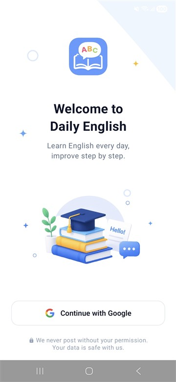
  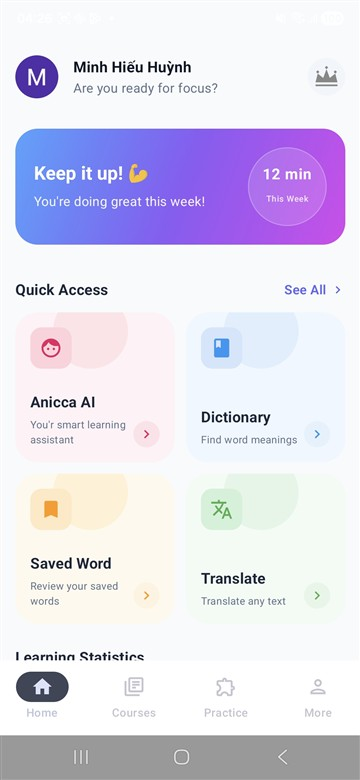
  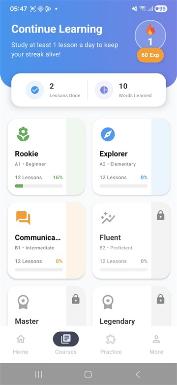
  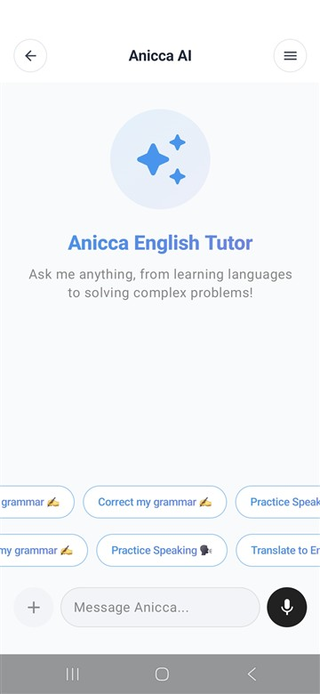
</p>

---

## 1. Background and goals

**Problem.** Traditional English learning apps lean heavily on theory and quickly become boring, especially for beginners and busy people.

**Solution.** Daily English delivers short lessons (around 8 minutes each), rewards progress (XP, streaks, stars, leaderboard) and lets learners practise speaking with an AI partner.

**Goals**

- Build a native Android app.
- Cover all core skills: vocabulary, grammar, listening and speaking.
- Provide a complete set of study tools (dictionary, flashcards, saved words, translation).
- Keep learners motivated with gamification.

## 2. Features

| Area | What it does |
|---|---|
| **Sign-in** | One-tap **Continue with Google** (Credential Manager). |
| **Courses** | Six levels: Rookie (A1), Explorer (A2), B1 Intermediate, Fluent (B2), Master and Legendary. Higher levels unlock as you progress; some are VIP only. Each course shows lessons done and progress %. |
| **Interactive lessons** | A lesson preview (topic, duration, XP, what you will learn), then mixed exercises: vocabulary cards, multiple choice, fill in the blank, listening multiple choice, sentence builder and **speaking** with a pronunciation score. A result screen shows accuracy, stars and streak. |
| **AI assistant (Anicca AI)** | Chat tutor powered by Gemini: correct my grammar, practise speaking, translate to English. Keeps a chat history. |
| **AI speaking practice** | Pick a topic (Free Talk, Business, Travel, Food) and hold a spoken conversation with an AI speaking partner, with voice input. |
| **Dictionary** | Search words and idioms, recent searches, topic lists (Business, Travel, Food…), word detail with phonetics and audio, and a daily quote. |
| **Saved words and flashcards** | Save words, then review them as flashcards (front/back, audio, normal and slow playback, "Forgot" / "Know it", learning vs. mastered counters). |
| **Translate** | Vietnamese ⇄ English text translation with voice input, text-to-speech, copy and history. |
| **Learning statistics** | Weekly study-time chart, lessons done, words learned, EXP and daily streak on Home and Courses. |
| **Leaderboard** | Rank by **EXP** or **Streak**, filtered by All / This week / This month, with your current position. |
| **VIP subscription** | Annual and quarterly PRO plans that remove ads and unlock VIP courses. Payment by bank-transfer **VietQR**, confirmed automatically (SePay). |
| **Ads** | Google AdMob banner and interstitial ads for free users. |
| **Notifications** | Daily reminders, for example "Protect your learning streak!". |
| **Profile** | Personal information and a *More* menu. |

## 3. Screenshots

### Onboarding and home

| Login | Home | Learning statistics | Profile | More |
|:---:|:---:|:---:|:---:|:---:|
|  |  | 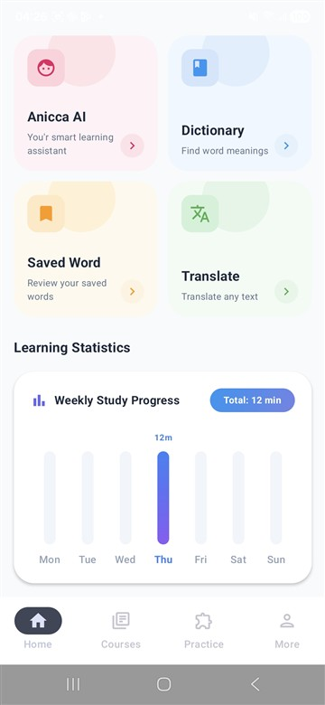 | 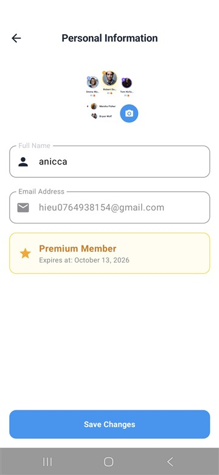 | 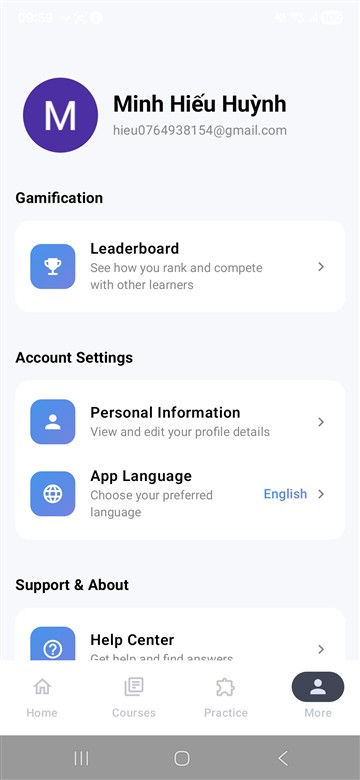 |

### Courses and lessons

| Courses | Course detail | Lesson preview | Vocabulary | Multiple choice |
|:---:|:---:|:---:|:---:|:---:|
|  | 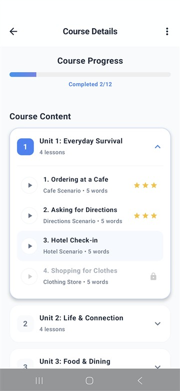 | 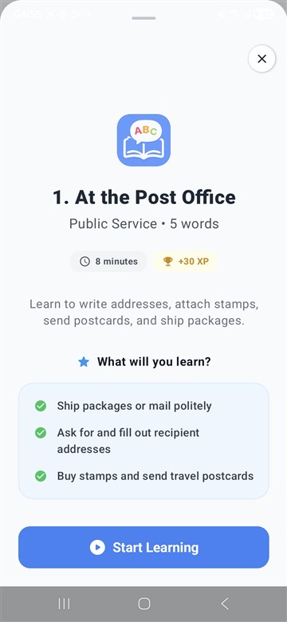 | 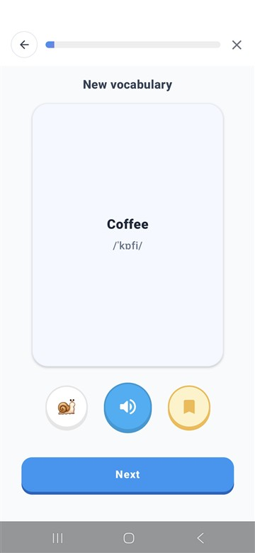 | 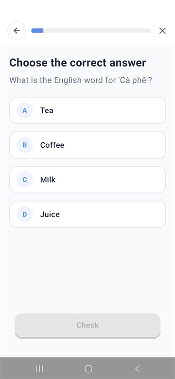 |

| Fill in the blank | Listening | Sentence builder | Speaking | Lesson complete |
|:---:|:---:|:---:|:---:|:---:|
| 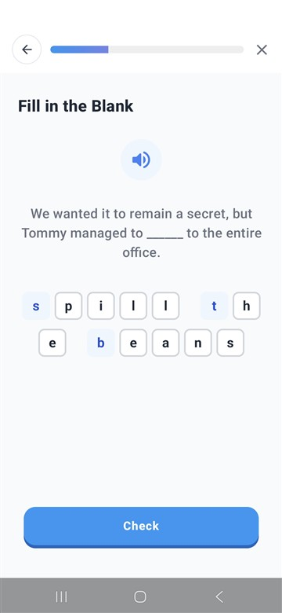 | 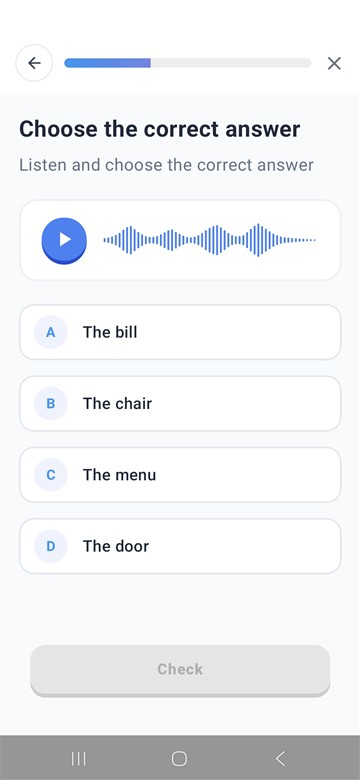 | 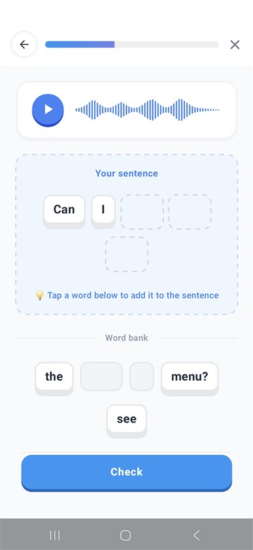 | 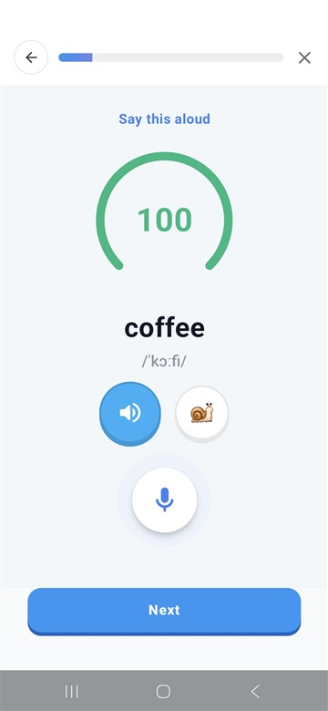 | 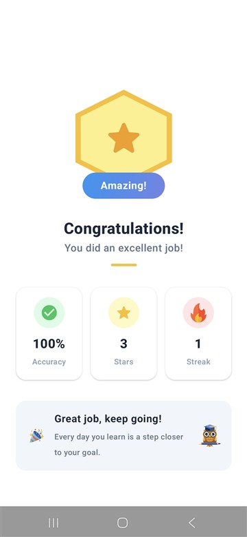 |

### AI practice

| Practice hub | AI speaking partner | Anicca AI chat |
|:---:|:---:|:---:|
| 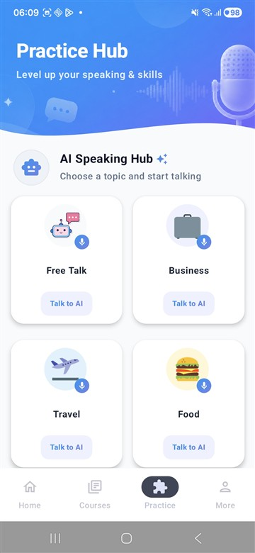 | 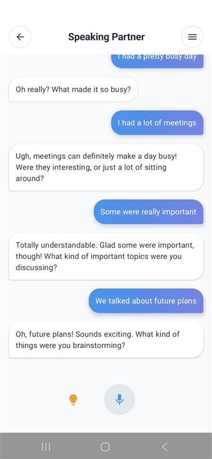 |  |

### Dictionary, saved words, flashcards and translate

| Dictionary | Word detail | Saved words | Translate |
|:---:|:---:|:---:|:---:|
| 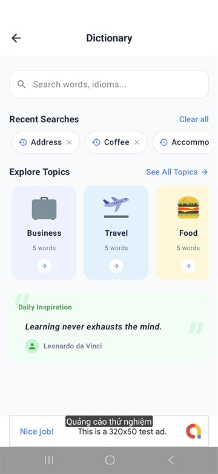 | 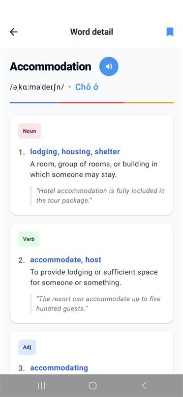 | 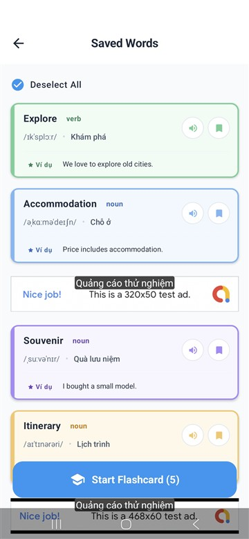 | 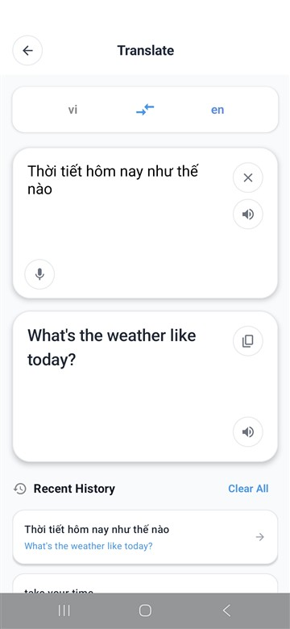 |

| Flashcard | Flashcard result | Leaderboard | Notification |
|:---:|:---:|:---:|:---:|
| 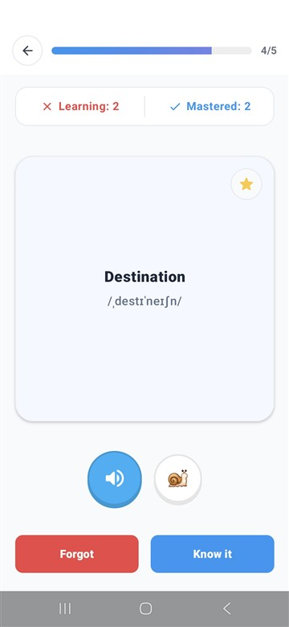 | 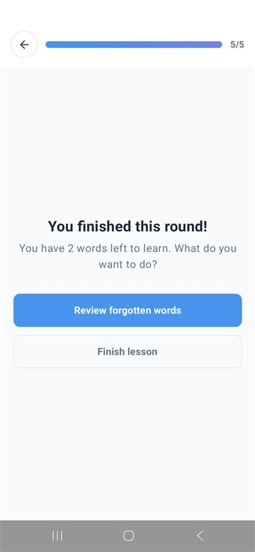 | 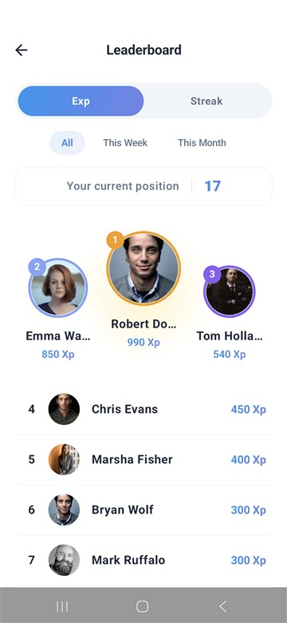 | 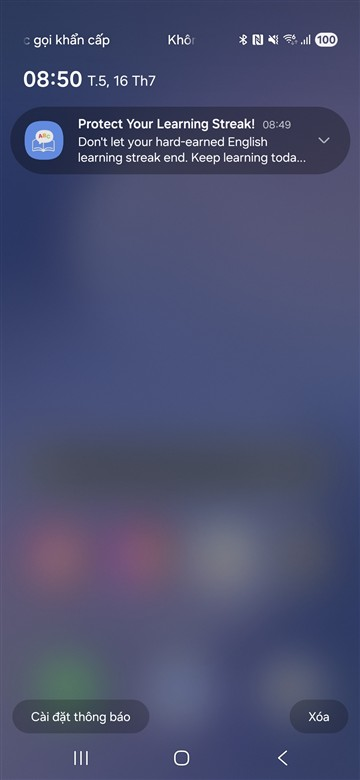 |

### VIP subscription and ads

| Subscription | VietQR payment | Interstitial ad |
|:---:|:---:|:---:|
| 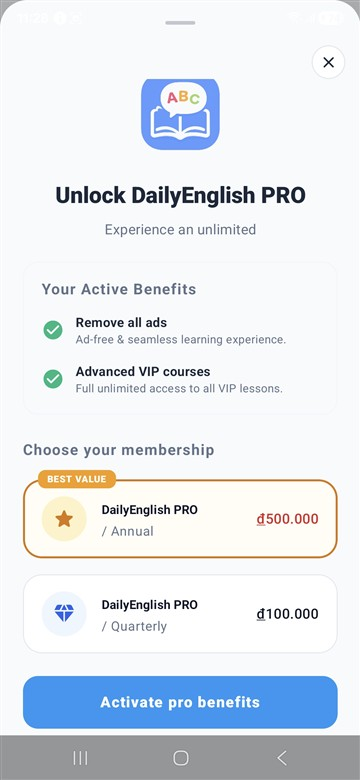 | 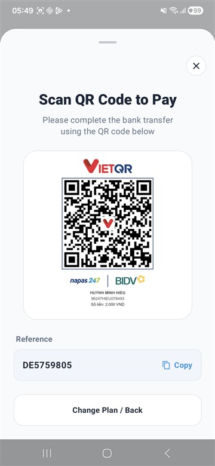 | 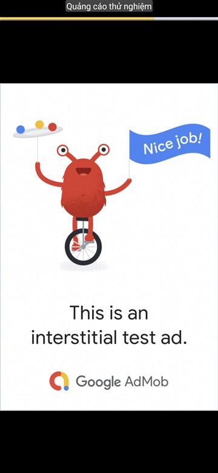 |

## 4. System architecture

```
┌──────────────────────┐   REST (Retrofit)   ┌──────────────────────┐      ┌──────────────┐
│  Android client      │ ──────────────────▶ │  Backend server      │ ───▶ │ PostgreSQL   │
│  Kotlin + Compose    │ ◀────────────────── │  Spring Boot REST    │      └──────────────┘
│  Clean Arch + MVI    │                     │  business + security │
└─────────┬────────────┘                     └─────────┬────────────┘
          │                                            │
          ▼                                            ▼
   Gemini AI (chat, speaking)              VietQR / SePay (payment)
   Google Translate, Google Sign-In, AdMob
```

| Layer | Technology |
|---|---|
| **Mobile client** | Android (Kotlin), Jetpack Compose, Clean Architecture + MVI |
| **Backend** | Spring Boot REST API: business logic and security (separate project, not in this repo) |
| **Database** | PostgreSQL |
| **Cloud services** | Gemini AI, Google Translate, VietQR / SePay, Google Sign-In, AdMob |

## 5. Android app architecture

The app uses **Clean Architecture + MVI + Hilt**. Package: `com.codework.daily_english`.

### Data flow

```
Remote / Local → DTO → Mapper → Domain model → Repository → UseCase → ViewModel → UI
```

### Layers and folders

```
app/src/main/java/com/codework/dailyenglish/
├── core/            base (BaseViewModel, BaseUiState, BaseEffect), dispatchers, network (BaseResponse), result (AppResult)
├── data/<feature>/  local, mapper, remote (Api, DataSource, Dto), repository (RepositoryImpl)
├── di/              Hilt modules (NetworkModule, one module per feature…)
├── domain/<feature>/ model, repository (interfaces), usecase
├── presentation/
│   ├── screen/<feature>/   components, mvi (State, Event, Effect), FeatureScreen, FeatureViewModel
│   └── theme/
├── notification/    reminders
└── utils/           UiText
```

Features present in the code: `ai`, `ai_speaking`, `auth`, `courses`, `course_details`, `dictionary`, `flashcard`, `grammar`, `home`, `leaderboard`, `lessons`, `more`, `practice`, `subscription`, `topic`, `translate`, `user`, `vocab_list`, `word_detail`.

### Rules the code follows

- **Layers never mix.** The domain layer has no Android dependencies.
- **Naming:** `XxxDto` → `Xxx` (domain) → `XxxUi` (only when needed); `toDomain()` and `toUi()` mappers; `XxxRepository` / `XxxRepositoryImpl`; use cases named Verb + Noun (`GetUserProfileUseCase`); `XxxViewModel`.
- **Errors:** repositories never throw. Results are wrapped in `AppResult<T>` and mapped to user-friendly `UiText`.
- **DI (Hilt):** `@Binds` for interfaces, `@Provides` only for external libraries.
- **Coroutines:** `viewModelScope` in ViewModels, injected dispatchers for heavy work, no blocking of the main thread.
- **Use cases** apply business logic (combine repositories, transform data), not just pass calls through.
- **A UI model (`XxxUi`) is created only when the screen needs formatting, combined fields or UI-only state.** DTO → Domain mapping is always required.

### MVI

Each screen defines an immutable `State`, `Event`s and one-time `Effect`s:

```kotlin
data class FeatureState(val mainDataState: BaseUiState<DomainModelUi> = BaseUiState())

sealed interface FeatureEvent { data class OnItemClick(val id: String) : FeatureEvent }

sealed interface FeatureEffect : BaseEffect { data class NavigateToDetail(val id: String) : FeatureEffect }
```

State is updated only with `.copy()`. Events are handled in `when (event)` and effects are emitted with `sendEffect()`.

### Navigation

Navigation is effect-driven, with typed routes:

```
ViewModel (emit Effect) → UI (collect Effect) → NavGraph (handle) → NavController (execute)
```

- No `navController` in ViewModels or direct navigation from UI.
- Routes are `@Serializable` typed objects, never strings.
- `NavGraph` is the only place that calls `navController.navigate()`.

The `skills/` folder holds the AI-assistant guidelines for this architecture (`skills/clean_mvi` and `skills/navigation`), including the snippets and templates used to generate new features.

## 6. Tech stack

| | |
|---|---|
| Language | Kotlin 2.2 |
| UI | Jetpack Compose (Material 3), Navigation Compose, Coil |
| Architecture | Clean Architecture, MVI, Hilt (DI) |
| Networking | Retrofit, Gson, OkHttp logging interceptor |
| Local storage | Room |
| Async | Kotlin Coroutines / Flow |
| AI | Google Generative AI SDK (Gemini) |
| Auth | Google Sign-In via Credential Manager |
| Ads | Google AdMob |
| Build | Gradle (Kotlin DSL), AGP 8.11, `compileSdk` / `targetSdk` 36, `minSdk` 26 |

## 7. Getting started

**Requirements:** Android Studio (recent version), JDK 17+, an Android 8.0+ (API 26) device or emulator, and a running backend that exposes the REST API.

```bash
git clone https://github.com/anicca3S84/daily_english.git
cd daily_english
```

1. Create `local.properties` in the project root (it is git-ignored) and add:

   ```properties
   sdk.dir=<path to your Android SDK>
   GEMINI_API_KEY=<your Gemini API key>
   WEB_CLIENT_ID=<your Google OAuth web client ID>
   ```

2. Point the app at your backend by changing `BASE_URL` in `di/NetworkModule.kt`.
3. Open the project in Android Studio, let Gradle sync, and run the `app` configuration.

> Keep API keys out of the repository. Use `local.properties` only.

## 8. Results and future work

**Results**

- A complete product combining gamification and AI.
- Clean Architecture, MVI, Jetpack Compose and Spring Boot applied consistently.
- Learning, payment and advertising features all work end to end.

**Next steps**

- Optimise performance and publish on Google Play.
- Run a self-hosted AI model to replace third-party APIs and cut running costs.
- Add social features: friends and online chat between learners.

## 9. Author

**Huỳnh Minh Hiếu** (66PM, student ID 0189466), Hanoi University of Civil Engineering, Faculty of Information Technology.
Supervisor: MSc. Nguyễn Hồng Hạnh.
